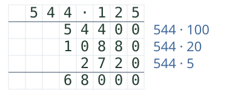
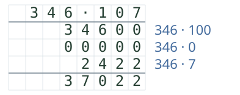
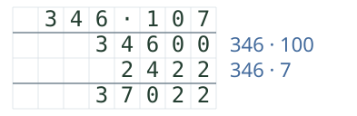
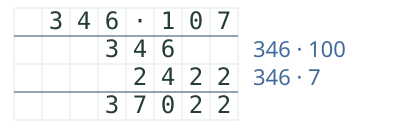
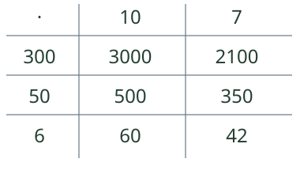
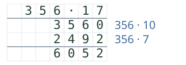
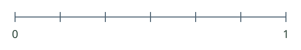

Die Sprechtexte sind editierbarer Text. Namen und Figuren lassen sich austauschen; unter jedem Beitrag können Modelle, Bilder oder Formeln stehen.

## 1 · Erst mal 8, dann mal 125

:::: {.schuelerdialog}
::: {.dialogbeitrag name="Leo" figur="brille" farbe="#2a7169"}
Ich multipliziere zuerst $68$ mit $8$.

{width=64mm}
:::
::: {.dialogbeitrag name="Till" figur="kurz"}
Mit deinem Ergebnis $544$ rechne ich weiter: mal $125$. Was fällt dir am Endergebnis auf?

{width=64mm}
:::
::::

Erkläre den Zusammenhang zwischen $68$ und dem Endergebnis. Prüfe ihn mit einer eigenen Startzahl. Tipp: Berechne $8\cdot125$.

## 2 · Nullen weglassen – aber die Stellen behalten

:::: {.schuelerdialog}
::: {.dialogbeitrag name="Esra" figur="zopf" farbe="#99536f"}
Bei $346\cdot107$ rechne ich auch mit $0$ Zehnern. So entsteht eine ganze Nullzeile.

{width=55mm}
:::
::: {.dialogbeitrag name="Leo" figur="brille" farbe="#2a7169"}
Deine Nullzeile trägt nichts zur Summe bei. Ich lasse sie weg; die übrigen Ziffern bleiben an ihren Stellen.

{width=55mm}
:::
::: {.dialogbeitrag name="Noah" figur="locken"}
Bei $346\cdot100$ schreibe ich die $6$ unter die Hunderter. Rechts davon lasse ich zwei Stellen frei.

{width=55mm}
:::
::::

Vergleiche die Rechnungen: Welche Nullen wurden weggelassen? Erkläre auch, warum man die $0$ im Faktor $107$ nicht einfach streichen darf.

[Seitenumbruch]

## 3 · Malkreuz und schriftliche Multiplikation

:::: {.schuelerdialog}
::: {.dialogbeitrag name="Mia" figur="zopf"}
Ich zerlege beide Faktoren im Malkreuz und addiere die sechs Teilprodukte.

{width=66mm}

$3000+500+60+2100+350+42=6052$
:::
::: {.dialogbeitrag name="Kim" figur="kurz"}
Ich fasse deine Teilprodukte zusammen: zuerst $356\cdot10$, dann $356\cdot7$. Beide Ergebnisse addiere ich.

{width=66mm}
:::
::::

Ordne Mias Felder Kims Teilprodukten zu. Erkläre, warum beide Wege zum gleichen Ergebnis führen.

## 4 · Dasselbe Dialogformat bei Brüchen

:::: {.schuelerdialog}
::: {.dialogbeitrag name="Nele" figur="locken"}
Ich teile das Ganze in sechs gleich große Teile. Eine Hälfte sind drei Sechstel.

$$\frac{1}{2}=\frac{3}{6}$$

:::
::: {.dialogbeitrag name="Jonas" figur="brille"}
Dann ist ein Drittel genauso viel wie zwei Sechstel. Jetzt können wir gleich große Teile zusammenzählen.

$$\frac{1}{3}=\frac{2}{6}$$

:::
::::

{width=125mm}

Markiere $\frac12$, $\frac13$ und ihre Summe auf derselben Strecke von $0$ bis $1$.

$\frac36+\frac26=$ [Antwortlinie 2cm]

Die Figuren können auch ohne Rechenmodelle verwendet werden, etwa für ein Gespräch über einen Text, eine Vermutung im Sachunterricht oder unterschiedliche Lösungswege.
